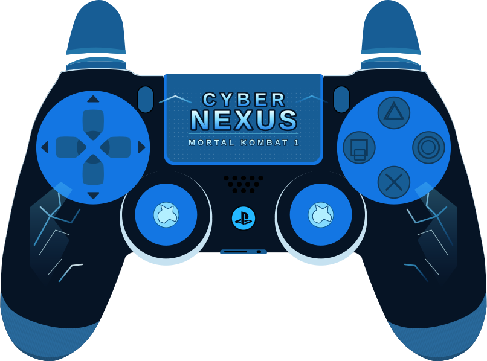

<div align="center">

# 🎮 CYBER NEXUS — CUSTOM GAMEPAD COLLECTION
### GamePad Viewer skins built for the Cyber Nexus stream

### 🌐 Language / Idioma
**🇺🇸 English:** use each project's `README.md`  
**🇪🇸 Español:** use each project's `README_ES.md`

| Project | 🇺🇸 English | 🇪🇸 Español |
|---|---|---|
| 🌊 Wuthering Waves — WuWa V1 | [English](wuwa-v1/README.md) | [Español](wuwa-v1/README_ES.md) |
| 🌆 Neverness to Everness — NTE V1 | [English](nte-v1/README.md) | [Español](nte-v1/README_ES.md) |
| ❄️ Mortal Kombat 1 — CYBER NEXUS V3 | [English](V3/README.md) | [Español](V3/README_ES.md) |

Custom PlayStation-style controller overlays for **Wuthering Waves**, **Neverness to Everness (NTE)** and **Mortal Kombat 1**.

Each controller has its own visual identity, assets and calibration while sharing the same goal: **showing controller inputs live on stream without using a generic controller skin.**

</div>

---

## 🎨 Wuthering Waves — Experimental V2 Skin Editor

The original **[WuWa V1](wuwa-v1/)** is preserved unchanged. Try the independent **[WuWa V2 customizer](https://unk0wnd3m0n.github.io/cyber-nexus-gamepad-skins/wuwa-v2/?bg=1)** to switch between three skins, three analog-stick symbols and custom controller colors.

**[🎮 TRY / CUSTOMIZE V2](https://unk0wnd3m0n.github.io/cyber-nexus-gamepad-skins/wuwa-v2/?bg=1)** · [README Español](wuwa-v2/README_ES.md) · [README English](wuwa-v2/README.md) · [Clean OBS overlay](https://unk0wnd3m0n.github.io/cyber-nexus-gamepad-skins/wuwa-v2/?overlay=1)

> Experimental: appearance options need live validation; controller detection and button coordinates are preserved from V1.

---

## 🎮 Mortal Kombat 1 — Current Controller Versions

The working MK1 controller overlays have been renamed for simpler versioning:

| Version | Folder | Live preview |
|---|---|---|
| V1 — Stable original | `V1/` | [Open V1](https://unk0wnd3m0n.github.io/cyber-nexus-gamepad-skins/V1/?bg=1) |
| V2 — Ice Dragon | `V2/` | [Open V2](https://unk0wnd3m0n.github.io/cyber-nexus-gamepad-skins/V2/?bg=1) |
| V3 — Larger CYBER NEXUS branding | `V3/` | [Open V3](https://unk0wnd3m0n.github.io/cyber-nexus-gamepad-skins/V3/?bg=1) |

Former folders: `mk1-v4 → V1`, `mk1-v5 → V2`, `mk1-v5.1 → V3`. Relative image and JS paths are preserved. Existing credits and license files remain in each version.

---

## 🎨 Controller Collection

<table><tr>
<td width="33%" align="center"><h3>🌊 Wuthering Waves — CYBER NEXUS V1</h3><a href="wuwa-v1/README_ES.md"></a><br><br><strong>STATUS: 🛠️ V1 VISUAL PREVIEW</strong><br>Jade Resonance Edition · CYBER NEXUS<br><br><a href="https://unk0wnd3m0n.github.io/cyber-nexus-gamepad-skins/wuwa-v1/?bg=1"></a><br><br><a href="wuwa-v1/README_ES.md">🇪🇸 README en español</a> · <a href="wuwa-v1/README.md">🇺🇸 English</a></td>
<td width="33%" align="center"><h3>🌆 Neverness to Everness — CYBER NEXUS V1</h3><a href="nte-v1/README_ES.md"></a><br><br><strong>STATUS: ✅ WORKING — V1</strong><br>Neon City Edition · CYBER NEXUS<br><br><a href="https://unk0wnd3m0n.github.io/cyber-nexus-gamepad-skins/nte-v1/?bg=1"></a><br><br><a href="nte-v1/README_ES.md">🇪🇸 README en español</a> · <a href="nte-v1/README.md">🇺🇸 English</a></td>
<td width="33%" align="center"><h3>❄️ Mortal Kombat 1 — CYBER NEXUS V3</h3><a href="V3/README_ES.md"></a><br><br><strong>STATUS: ✅ WORKING — V3</strong><br>Ice Dragon Edition · CYBER NEXUS<br><br><a href="https://unk0wnd3m0n.github.io/cyber-nexus-gamepad-skins/V3/?bg=1"></a><br><br><a href="V3/README_ES.md">🇪🇸 README en español</a> · <a href="V3/README.md">🇺🇸 English</a></td>
</tr></table>

---

## ⚡ Purpose

This repository is the home of the **Cyber Nexus custom controller overlay collection**. The project replaces the standard GamePad Viewer appearance with game-specific designs while preserving live controller input feedback.

The overlays are intended for livestreams and gameplay recordings using **OBS Studio**, browser sources and other compatible streaming software.

Each skin is developed independently so its artwork and input positions can be changed without affecting the other games.

## 🗂️ Project Layout

```text
cyber-nexus-gamepad-skins/
│
├── wuwa-v2/                          # 🌊 Experimental WuWa skin & color customizer
│   ├── index.html                    # Editor + viewer
│   ├── customizer.js                 # Skins, stick icons, color & saved settings
│   ├── main.js                       # Unchanged input mapping
│   ├── README_ES.md                  # Español
│   └── assets/                       # Three skins + stick emblems
│
├── wuwa-v1/                          # 🌊 Wuthering Waves Jade Resonance V1
│   ├── README.md                     # English
│   ├── README_ES.md                  # Español
│   ├── index.html                    # Live Gamepad API viewer
│   ├── main.js                       # Preserved working input mapping
│   ├── style.css                     # Jade/turquoise styling
│   ├── preview.svg                   # Homepage controller preview
│   ├── DRACULA-LICENSE.txt           # Upstream MIT attribution
│   └── assets/

│
├── nte-v1/                           # 🌆 NTE neon controller V1 (new)
│   ├── index.html                    # Interactive viewer
│   ├── README.md                     # English
│   ├── README_ES.md                  # Español
│   ├── main.js                       # V3 Gamepad API mapping
│   ├── style.css                     # Neon controller styling
│   ├── preview.svg                   # Controller artwork
│   └── assets/
│
├── V1/                               # ❄️ Mortal Kombat 1 — first working version
├── V2/                               # ❄️ Mortal Kombat 1 — Ice Dragon
├── V3/                               # ❄️ Mortal Kombat 1 — current featured version
│   ├── index.html                    # Live controller
│   ├── main.js                       # Gamepad input detection
│   ├── style.css                     # Animated button styling
│   ├── preview.svg                   # Homepage preview
│   ├── DRACULA-LICENSE.txt           # Original third-party assets attribution
│   └── assets/
└── index.html                        # Main collection landing page
```

## 🎮 Input System

Each finished controller is intended to support real-time feedback for:

**D-pad • Analog sticks • △ ○ × □ • Create/Options • L1/R1 • L2/R2 • Stick clicks**

The current Mortal Kombat 1 **V3** controller uses the Gamepad API to display live inputs in its own browser viewer. NTE V1 also uses the Gamepad API and inherits MK1 V3 input mapping. WuWa V1 and NTE V1 also use the Gamepad API with matching controller geometry.

## 🚧 Development Roadmap

### 🌊 Wuthering Waves
**Current:** new WuWa V1 jade controller and wave emblems based on NTE V1. Awaiting direct controller testing.

### 🌆 NTE
**Current:** NTE V1 neon controller copied from MK1 V3. Awaiting hands-on testing. The obsolete original `nte/` folder has been retired.

### ❄️ Mortal Kombat 1 — Sub-Zero
**Current:** V3 active and working, with ice-dragon design, touchpad branding and live button feedback.

---

## 🇪🇸 Español

Este repositorio contiene la **colección de controles personalizados de Cyber Nexus** para GamePad Viewer. Cada diseño reemplaza la apariencia estándar del control con una temática específica del juego, manteniendo la respuesta de los botones en tiempo real para streams y grabaciones.

La versión principal de Mortal Kombat 1 es **V3**, con visor propio y detección de botones. NTE tiene también una nueva versión `nte-v1/` en violeta neón, basada en MK1 V3. La carpeta antigua `nte/` fue eliminada; WuWa V1 reemplaza la carpeta antigua con una nueva versión jade.

### 🎨 Colección

**🌊 Wuthering Waves • 🌆 Neverness to Everness • ❄️ Mortal Kombat 1 — Sub-Zero**

Cada carpeta incluye un `README.md` en inglés y un `README_ES.md` en español. Los recursos técnicos y nombres de archivos se mantienen sin traducir para conservar la compatibilidad con GamePad Viewer y GitHub Pages.

### 🚧 Estado

✅ **MK1 V3 y NTE V1 funcionales** — WuWa V1 disponible para pruebas.

---

## © Copyright / Derechos de autor

**🇺🇸 © 2026 Cyber Nexus. All rights reserved.** Original CYBER NEXUS designs and assets belong to **Cyber Nexus**; third-party Dracula-derived graphics retain their MIT license and notices. Unauthorized copying, redistribution, modification or commercial use is prohibited and may result in appropriate legal action to protect the creator's rights.

**🇪🇸 © 2026 Cyber Nexus. Todos los derechos reservados.** Los diseños y recursos originales de CYBER NEXUS pertenecen a **Cyber Nexus**; los gráficos derivados de Dracula conservan sus avisos y licencia MIT. Queda prohibida su copia, redistribución, modificación o uso comercial no autorizado. Cualquier uso no autorizado podrá dar lugar a las acciones legales correspondientes para proteger los derechos del autor.

Game names, characters, logos and other third-party intellectual property remain the property of their respective owners.  
Los nombres de juegos, personajes, logotipos y demás propiedad intelectual de terceros pertenecen a sus respectivos propietarios.

---

<div align="center">

## ⚡ CYBER NEXUS

**Wuthering Waves 🌊 • NTE 🌆 • Mortal Kombat 1 ❄️**

Custom controller overlays built for the **Cyber Nexus** streaming community.  
Controles personalizados creados para la comunidad de streaming de **Cyber Nexus**.

</div>
