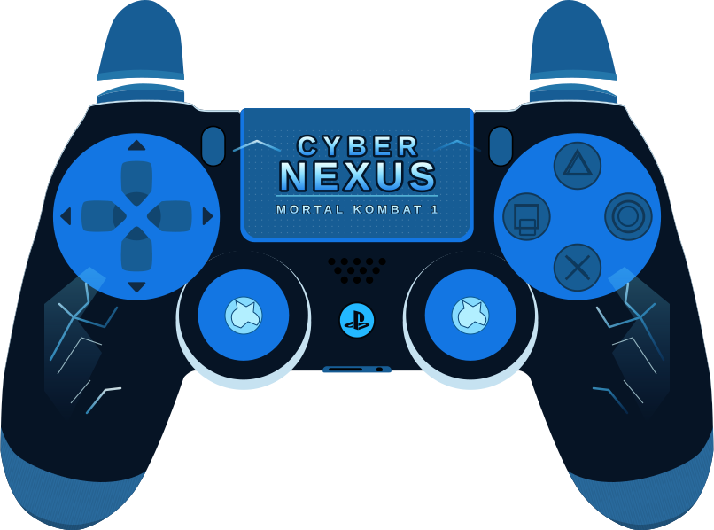

# ❄️ CYBER NEXUS × Mortal Kombat 1 — V3 Controller

This folder contains **Mortal Kombat 1 — CYBER NEXUS V3**, the featured PlayStation-style controller overlay for CYBER NEXUS streams.

  

  

<a href="https://unk0wnd3m0n.github.io/cyber-nexus-gamepad-skins/V3/">Transparent overlay</a> · <a href="README_ES.md">🇪🇸 Leer en español</a>

## 🎨 Design

The V3 retains the **classic DualShock 4 (PS4) silhouette** with icy-blue Mortal Kombat styling, a large **CYBER NEXUS / MORTAL KOMBAT 1** touchpad logo, dragon crests on both analog sticks, frosted-glass details and illuminated button presses.

## 🎮 Try the controller

Choose **TRY CONTROL** above. Connect a compatible controller over USB or Bluetooth, open the viewer in Chrome or Edge, then press a button to activate Gamepad API input tracking.

**D-pad • △ ○ × □ • L1/R1 • L2/R2 • Analog sticks and L3/R3 • Create/Options • PS button • Touchpad**

Use the [input diagnostic mode](https://unk0wnd3m0n.github.io/cyber-nexus-gamepad-skins/V3/?bg=1&debug=1) to see browser button indices.

> ✅ **Status: WORKING.** The controller's core inputs have been tested in the project's setup. Other controller and OBS Browser Source compatibility may vary.

## 📂 Project files

- `index.html` — interactive viewer
- `main.js` — Gamepad API input handling
- `style.css` — controller layout and button effects
- `preview.svg` — homepage preview
- `assets/` — independent artwork and decorative SVGs
- `DRACULA-LICENSE.txt` — license and attribution for third-party controller artwork

## 📺 OBS

Try the [transparent overlay](https://unk0wnd3m0n.github.io/cyber-nexus-gamepad-skins/V3/). If OBS Browser Source doesn't expose the connected gamepad, capture the Chrome/Edge window instead.

Earlier revisions: [V1](../V1/) · [V2](../V2/).

---

## © Credits and license

**© 2026 CYBER NEXUS** for original CYBER NEXUS designs. Some underlying controller artwork is derived from [Dracula Gamepad Viewer](https://github.com/dracula/gamepad-viewer), distributed under the MIT license with attribution preserved in [DRACULA-LICENSE.txt](DRACULA-LICENSE.txt). Mortal Kombat names and marks belong to their respective owners.
