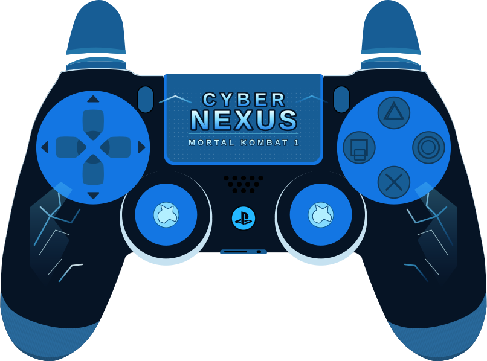

# ❄️ Control CYBER NEXUS × Mortal Kombat 1 — V3

Esta carpeta contiene el diseño principal **Mortal Kombat 1 — CYBER NEXUS V3**, creado para mostrar las pulsaciones de un mando PlayStation durante las transmisiones de **CYBER NEXUS**.

  

  

  <a href="https://unk0wnd3m0n.github.io/cyber-nexus-gamepad-skins/V3/">🎥 Vista transparente para overlay</a>
  &nbsp;•&nbsp;
  <a href="https://github.com/Unk0wnD3m0n/cyber-nexus-gamepad-skins">📁 Colección principal</a>

## 🎨 Diseño del control

La V3 conserva la **silueta clásica del DualShock 4 (PS4)** con una personalización azul hielo inspirada en Mortal Kombat 1. Incluye:

- **CYBER NEXUS** en grande y **MORTAL KOMBAT 1** en el panel central.
- Emblemas de dragón helado en ambos sticks.
- Efectos de cristal y grietas de hielo.
- Iluminación de botones y cruceta cuando se presionan.
- Gráficos SVG separados para poder mantener el diseño y su funcionamiento.

## 🎮 Probar el control — TRY

Pulsa el botón **TRY CONTROL — PROBAR V3** de arriba y conecta un mando compatible por **USB o Bluetooth**. En **Chrome o Edge**, presiona cualquier botón para que el navegador detecte el control.

El visor utiliza la **Gamepad API**, no requiere instalar la skin de GamePad Viewer clásico. El mapeo habitual incluye:

**Cruceta • △ ○ × □ • L1/R1 • L2/R2 • Sticks y clics L3/R3 • Create/Options • PS • Touchpad**

Para comprobar los números de botones detectados, utiliza el [modo diagnóstico](https://unk0wnd3m0n.github.io/cyber-nexus-gamepad-skins/V3/?bg=1&debug=1).

> ✅ **Estado: FUNCIONAL.** El diseño y la respuesta de los botones fueron probados con el control del proyecto. La compatibilidad con otros mandos o con la fuente de navegador integrada de OBS puede variar.

## 📂 Recursos

Los archivos están separados de los proyectos de WuWa y NTE:

- `index.html` — visor interactivo.
- `main.js` — detección y respuesta del mando.
- `style.css` — posiciones, animaciones y colores.
- `preview.svg` — imagen de portada del control.
- `assets/` — gráficos SVG del cuerpo, botones, sticks, dragones, touchpad y hielo.
- `DRACULA-LICENSE.txt` — licencia y atribución de los recursos de Dracula utilizados y modificados.

## 📺 Uso en OBS

Para mostrar el control en un stream, abre la [vista transparente](https://unk0wnd3m0n.github.io/cyber-nexus-gamepad-skins/V3/) en tu navegador y comprueba las entradas. Si la fuente **Browser Source** de OBS no detecta el mando, utiliza **Captura de ventana** del navegador.

Las versiones anteriores siguen disponibles: [V1](../V1/) y [V2](../V2/).

---

## © Derechos de autor

**© 2026 CYBER NEXUS.** Los diseños y recursos originales de CYBER NEXUS pertenecen a su creador. Parte de los recursos gráficos del mando proceden del proyecto [Dracula Gamepad Viewer](https://github.com/dracula/gamepad-viewer) y conservan su licencia MIT y atribución en [DRACULA-LICENSE.txt](DRACULA-LICENSE.txt). Los nombres y marcas de Mortal Kombat pertenecen a sus respectivos titulares.
