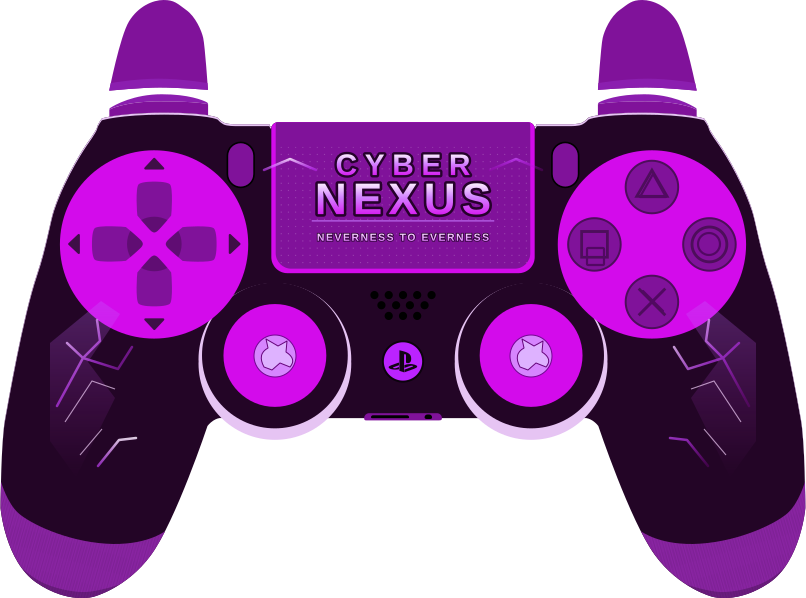

# 🌆 CYBER NEXUS × Neverness to Everness — V1 Controller

This folder contains **Neverness to Everness — CYBER NEXUS NTE V1**, an experimental PlayStation-style controller overlay for CYBER NEXUS streams.

The V1 uses the same proven geometry and Gamepad API code as MK1 V3, with a new **violet and magenta futuristic city** identity.

  

  

<a href="https://unk0wnd3m0n.github.io/cyber-nexus-gamepad-skins/nte-v1/">Transparent overlay</a> · <a href="README_ES.md">🇪🇸 Leer en español</a>

## 🎨 Design

NTE V1 retains the **classic DualShock 4 (PS4) silhouette** with vivid purple and magenta cyber-city styling, a large **CYBER NEXUS / NEVERNESS TO EVERNESS** touchpad logo, new **neon N hexagon symbols on both analog sticks** instead of the previous dragon/shark-like designs, decorative illuminated details and button-press highlights.

## 🎮 Try the controller

Choose **TRY CONTROL** above. Connect a compatible controller over USB or Bluetooth, open the viewer in Chrome or Edge, then press a button to activate Gamepad API tracking.

**D-pad • △ ○ × □ • L1/R1 • L2/R2 • Analog sticks and L3/R3 • Create/Options • PS button • Touchpad**

Use the [input diagnostic mode](https://unk0wnd3m0n.github.io/cyber-nexus-gamepad-skins/nte-v1/?bg=1&debug=1) to view browser button indices.

> 🛠️ **Status: V1 PROTOTYPE.** Input mapping matches MK1 V3, but the new NTE styling still needs hands-on validation. Other controller and OBS Browser Source compatibility may vary.

## 📂 Project files

- `index.html` — interactive viewer
- `main.js` — Gamepad API input handling, unchanged from MK1 V3
- `style.css` — controller layout and neon button effects
- `preview.svg` — homepage preview showing the new icons
- `assets/` — controller and decorative SVG artwork
- `assets/neon-monogram.svg` — original neon N stick emblem
- `DRACULA-LICENSE.txt` — MIT license and attribution for original third-party controller artwork

## 📺 OBS

Try the [transparent overlay](https://unk0wnd3m0n.github.io/cyber-nexus-gamepad-skins/nte-v1/). If OBS Browser Source doesn't expose the connected gamepad, capture the Chrome/Edge window instead.

The obsolete original NTE folder was removed; [MK1 V3](../V3/) stays unchanged.

---

## © Credits and license

**© 2026 CYBER NEXUS** for original CYBER NEXUS designs. Some underlying controller artwork is derived from [Dracula Gamepad Viewer](https://github.com/dracula/gamepad-viewer), distributed under the MIT license with attribution preserved in [DRACULA-LICENSE.txt](DRACULA-LICENSE.txt). Neverness to Everness names and marks belong to their respective owners.
