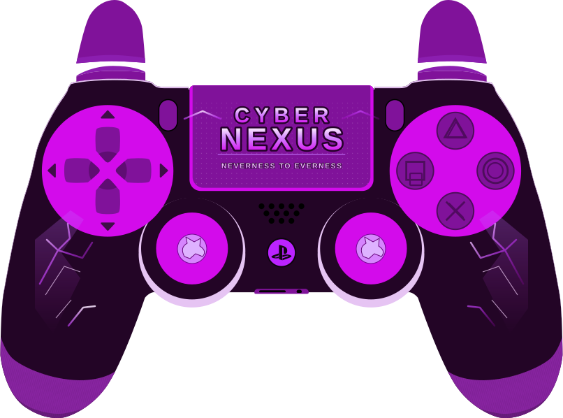

# 🌆 Control CYBER NEXUS × Neverness to Everness — V1

Esta carpeta contiene la primera versión del control **Neverness to Everness — CYBER NEXUS NTE V1**, creada para mostrar las pulsaciones de un mando PlayStation durante las transmisiones de **CYBER NEXUS**.

El diseño parte de la geometría y el código de MK1 V3, pero tiene una identidad de **ciudad futurista en violeta y magenta neón**.

  

  

  <a href="https://unk0wnd3m0n.github.io/cyber-nexus-gamepad-skins/nte-v1/">🎥 Vista transparente para overlay</a>
  &nbsp;•&nbsp;
  <a href="https://github.com/Unk0wnD3m0n/cyber-nexus-gamepad-skins">📁 Colección principal</a>
  &nbsp;•&nbsp;
  <a href="README.md">🇺🇸 English</a>

## 🎨 Diseño del control

La NTE V1 conserva la **silueta clásica del DualShock 4 (PS4)**, pero con una estética urbana y tecnológica. Incluye:

- **CYBER NEXUS** grande y **NEVERNESS TO EVERNESS** en el panel central.
- Nuevos símbolos originales de **N futurista dentro de un hexágono neón** en ambos sticks (sin dragones ni tiburones).
- Acabados violetas, magenta y luces neón.
- Detalles luminosos en la carcasa y el touchpad.
- Iluminación de botones y cruceta cuando se presionan.
- Gráficos SVG independientes para mantener intactas las coordenadas del control.

## 🎮 Probar el control — TRY

Pulsa el botón **TRY CONTROL — PROBAR NTE V1** de arriba y conecta un mando compatible por **USB o Bluetooth**. En **Chrome o Edge**, presiona cualquier botón para que el navegador detecte el control.

El visor utiliza la **Gamepad API**; no necesita instalar una skin para el GamePad Viewer clásico. El mapeo habitual incluye:

**Cruceta • △ ○ × □ • L1/R1 • L2/R2 • Sticks y clics L3/R3 • Create/Options • PS • Touchpad**

Para comprobar los números de botones detectados, utiliza el [modo diagnóstico](https://unk0wnd3m0n.github.io/cyber-nexus-gamepad-skins/nte-v1/?bg=1&debug=1).

> 🛠️ **Estado: PROTOTIPO V1.** Conserva el mapeo de botones de MK1 V3, pero esta versión de NTE todavía necesita validación visual y funcional con el mando. La compatibilidad con OBS puede variar.

## 📂 Recursos

Los archivos están separados de los proyectos MK1 V3, WuWa y del antiguo NTE:

- `index.html` — visor interactivo.
- `main.js` — detección y respuesta del mando basada en MK1 V3.
- `style.css` — posiciones, animaciones y colores de neón.
- `preview.svg` — imagen de portada del control.
- `assets/` — SVG de cuerpo, botones, sticks, emblemas N, touchpad y efectos.
- `assets/neon-monogram.svg` — nuevo símbolo futurista de los sticks.
- `DRACULA-LICENSE.txt` — licencia y atribución de los recursos Dracula utilizados y modificados.

## 📺 Uso en OBS

Para mostrar el control en un stream, abre la [vista transparente](https://unk0wnd3m0n.github.io/cyber-nexus-gamepad-skins/nte-v1/) en tu navegador y comprueba las entradas. Si la fuente **Browser Source** de OBS no detecta el mando, utiliza **Captura de ventana** del navegador.

El antiguo skin [NTE](../nte/) permanece guardado como respaldo, y [MK1 V3](../V3/) sigue independiente.

---

## © Derechos de autor

**© 2026 CYBER NEXUS.** Los diseños y recursos originales de CYBER NEXUS pertenecen a su creador. Parte de los recursos gráficos del mando proceden del proyecto [Dracula Gamepad Viewer](https://github.com/dracula/gamepad-viewer) y conservan su licencia MIT y atribución en [DRACULA-LICENSE.txt](DRACULA-LICENSE.txt). Los nombres y marcas de Neverness to Everness pertenecen a sus respectivos titulares.
