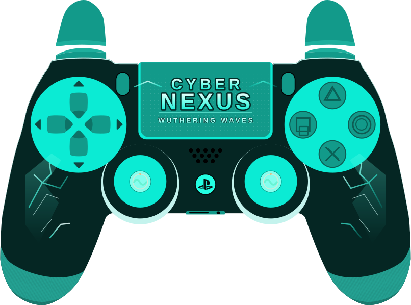

# 🌊 CYBER NEXUS × Wuthering Waves — Customizable V2

**WuWa V2** is a separate experimental controller based on the working **WuWa V1** geometry and unchanged Gamepad API mapping. It adds an interactive style panel without altering button positions.

<a href="https://unk0wnd3m0n.github.io/cyber-nexus-gamepad-skins/wuwa-v2/?overlay=1">Clean OBS overlay</a> · <a href="README_ES.md">🇪🇸 Leer en español</a> · <a href="../wuwa-v1/">Original V1</a>

## 🎨 Customization
**3 skins** (Jade Resonance, Dark Jade, Light Aqua), **3 stick icons** (Wave, Pulse, Orbit), custom hue selection and color swatches. Settings are saved per-browser with `localStorage`, with a one-click reset option. Open/close the editor using the **🎨 Personalizar** button.

## 🎮 Try the controller
Use the TRY link above. Connect a compatible controller through USB/Bluetooth and press a button in Chrome/Edge. The mapping remains identical to WuWa V1: **D-pad, face buttons, shoulders/triggers, analog sticks, L3/R3, Create/Options, PS and touchpad**.

[Button diagnostics](https://unk0wnd3m0n.github.io/cyber-nexus-gamepad-skins/wuwa-v2/?bg=1&debug=1).

> 🧪 **EXPERIMENTAL:** Customizer and new skin graphics still require hands-on testing. Input JavaScript is unchanged.

## 📺 OBS
Use [the clean overlay](https://unk0wnd3m0n.github.io/cyber-nexus-gamepad-skins/wuwa-v2/?overlay=1) to hide the editor, or add `?bg=1` for a dark background.

## 📁 Files
`index.html`, `main.js` (unchanged), `customizer.js`, `style.css`, `preview.svg`, `assets/`, and `DRACULA-LICENSE.txt`.

**WuWa V1, MK1 V1–V3 and NTE V1 stay untouched.**

---

## © Credits
© 2026 CYBER NEXUS for original designs. Base artwork derives in part from [Dracula Gamepad Viewer](https://github.com/dracula/gamepad-viewer), MIT attribution retained in [DRACULA-LICENSE.txt](DRACULA-LICENSE.txt).
